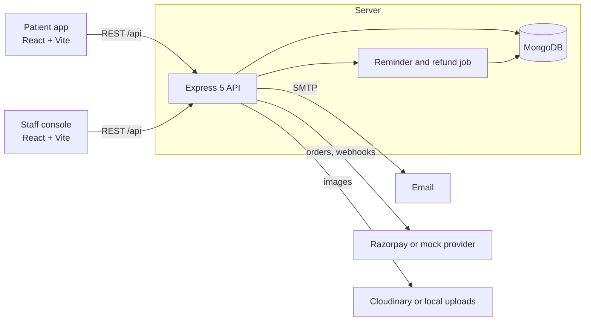

# BookMyAppointments

A doctor-appointment booking system with three parts: a REST API, a patient web app and a staff console for
administrators and doctors. Patients find a doctor, pick a real open slot, book, pay and review the visit.
Doctors run their calendar and consultations. Administrators manage the clinic and see how it performs.

The wire contract between the three parts is [`docs/API.md`](docs/API.md). How things work inside is in
[`docs/ARCHITECTURE.md`](docs/ARCHITECTURE.md); day-to-day workflow is in [`docs/DEVELOPMENT.md`](docs/DEVELOPMENT.md).

## Features

**Patients** (`Book-My-Appointment/`)
- Register with an emailed one-time code, sign in with a password or Google, reset a forgotten password.
- Search doctors by name, speciality, fee and availability; read profiles and reviews.
- See only genuinely bookable times, week by week, limited to the clinic's booking window.
- Book, pay (mock gateway or Razorpay), reschedule (up to twice) and cancel within the clinic's cutoff.
- Read consultation notes and the prescription, print them, and review the doctor.
- Notifications, profile with photo, add an appointment to a calendar (.ics).

**Doctors** (`admin/`, doctor role)
- Calendar and list of appointments; complete a visit with notes and a prescription, mark no-shows, cancel.
- Weekly schedule with breaks and slot length, leave days (optionally cancelling affected bookings).
- Profile, fees and availability, earnings dashboard, a patient's history with them.

**Administrators** (`admin/`, admin role)
- Dashboard with analytics: totals, revenue, cancellation rate, time series, specialities, top doctors.
- Create and edit doctors (with photo and schedule), activate or deactivate them, toggle availability.
- Patients: search, view appointments, block and unblock.
- Appointments across the clinic, cancel any booking, CSV export.
- Specialities, review moderation, clinic settings, audit log.

## Architecture



## Tech stack

| Part | Stack |
|---|---|
| API | Node 20, Express 5, Mongoose 9, MongoDB 7, zod, JWT, bcrypt, pino, helmet, multer, nodemailer |
| Patient app | React 18, Vite 5, Tailwind CSS 3, Redux Toolkit, React Router 6, axios |
| Staff console | React 18, Vite 5, Tailwind CSS 3, Redux Toolkit, React Router 6, axios, hand-written SVG charts |
| Tests | Vitest and supertest (API), Vitest and Testing Library (apps), Playwright with Google Chrome (e2e) |
| Delivery | Docker, Docker Compose, GitHub Actions |

## Quick start with Docker Compose

```bash
cp .env.example .env
# Fill in JWT_ACCESS_SECRET, JWT_REFRESH_SECRET (openssl rand -hex 32), ADMIN_EMAIL and ADMIN_PASSWORD_HASH.
# Create the hash with:
docker compose run --rm --no-deps backend node scripts/hash-password.js 'YourPassword1'
# Create the data-encryption key and paste the line into DATA_ENCRYPTION_KEYS (see "Data encryption" below):
docker compose run --rm --no-deps backend node scripts/generate-key.js
# Also set DATA_ENCRYPTION_ACTIVE_KEY_ID to that key's id, and the three RAZORPAY_* values.
docker compose up --build -d
docker compose --profile seed run --rm seed     # optional demo data
```

This is the **production stack**. It sets `PAYMENTS_MODE=razorpay` and `docker compose` stops with a clear message
if `RAZORPAY_KEY_ID`, `RAZORPAY_KEY_SECRET`, `RAZORPAY_WEBHOOK_SECRET` or the encryption settings are missing. Mock
payments cannot be enabled for it, and the API itself refuses to start in production in mock mode.

### Trying it locally with mock payments (demo stack)

`docker-compose.demo.yml` is a separate, **local evaluation only** stack: `NODE_ENV=development` and mock
payments, where any `mock_*` payment is accepted without a charge. It needs the same `.env` (JWT, admin and
encryption values) but no Razorpay keys. Compose checks required variables per file, so the demo is a complete stack
of its own rather than an override layered on `docker-compose.yml`:

```bash
docker compose -f docker-compose.demo.yml up --build -d
docker compose -f docker-compose.demo.yml --profile seed run --rm seed
```

Never expose the demo stack to the internet or put real patient data in it.

| Service | URL |
|---|---|
| Patient app | <http://localhost:5173> |
| Staff console | <http://localhost:5174> |
| API health | <http://localhost:4000/api/health> |

The production API runs with `NODE_ENV=production`, so it applies the production checks listed under
[Security notes](#security-notes). Without `SMTP_HOST` the one-time codes that new patients need are discarded;
the seeded accounts below work regardless. `PUBLIC_API_URL` is compiled into both apps, so run
`docker compose build` after changing it. Stop everything with `docker compose down` (add `-v` to delete the data).

## Quick start for local development

Requires Node 20 (`nvm use`) and a MongoDB 6+ server, for example `docker run -d -p 27017:27017 mongo:7`.

```bash
# API: http://localhost:4000
cd Backend && npm ci
cp .env.example .env            # fill in the two JWT secrets, ADMIN_EMAIL, ADMIN_PASSWORD_HASH and the encryption key
npm run generate-key            # prints a DATA_ENCRYPTION_KEYS entry; set DATA_ENCRYPTION_ACTIVE_KEY_ID to its id
npm run seed && npm run dev

# Patient app: http://localhost:5173
cd Book-My-Appointment && npm ci && cp .env.example .env.local && npm run dev

# Staff console: http://localhost:5174
cd admin && npm ci && cp .env.example .env.local && npm run dev
```

In development, emails are captured instead of sent. The API logs each message (including the OTP or reset link)
at `debug` level, which is the default level outside production.

## Environment variables

| File | Used by |
|---|---|
| [`.env.example`](.env.example) | Docker Compose (secrets, ports, public URLs) |
| [`Backend/.env.example`](Backend/.env.example) | the API, every option commented |
| [`Book-My-Appointment/.env.example`](Book-My-Appointment/.env.example) | patient app (`VITE_API_URL`, optional `VITE_GOOGLE_CLIENT_ID`) |
| [`admin/.env.example`](admin/.env.example) | staff console (`VITE_API_URL`) |

Real `.env` files are git-ignored. Never commit them.

## Seeded demo accounts

`npm run seed` (or the Compose `seed` service) is idempotent and creates 6 specialities, 12 doctors, 8 patients and
about 60 appointments in every status.

| Role | Sign in at | Email | Password |
|---|---|---|---|
| Patient | patient app | `demo.patient@example.com` | `Demo@12345` |
| Doctor | staff console, "Doctor" | `aarav.sharma@clinic.example.com` (and 11 more) | `Doctor@12345` |
| Admin | staff console, "Admin" | your `ADMIN_EMAIL` | the password you hashed |

These are demo credentials for throwaway databases. Do not seed a production database.

## Running the tests

| Suite | Command | Needs |
|---|---|---|
| API | `cd Backend && npm test` (`npm run test:coverage` for coverage) | MongoDB: set `MONGODB_URI_TEST`, or `mongodb-memory-server` downloads one |
| Patient app | `cd Book-My-Appointment && npm test` | nothing |
| Staff console | `cd admin && npm test` | nothing |
| End to end | `cd e2e && npm ci && npm run setup && npm test` | Docker with `mongo:7` (or `E2E_MONGODB_URI`) and Google Chrome |

The e2e command starts a throwaway MongoDB, seeds it, runs the API and both apps on ports 4100, 5273 and 5274,
drives them with Chrome, and tears everything down. See [`docs/DEVELOPMENT.md`](docs/DEVELOPMENT.md) for details.

## Project layout

```
Backend/              Express API (src/modules/<domain>), seed and tooling scripts, tests
Book-My-Appointment/  patient SPA
admin/                staff SPA (admin and doctor roles)
e2e/                  Playwright suite and the script that boots the whole stack
docs/                 API.md (contract), ARCHITECTURE.md, DEVELOPMENT.md
docker-compose.yml    mongo, backend, patient, staff and an optional seed job
.github/workflows/    CI
```

## Data encryption

Appointment reasons, consultation notes and prescriptions are encrypted by the API before they reach MongoDB, with
AES-256-GCM and a random IV per value. The API's responses are unchanged. Keys come from the environment:

```bash
cd Backend && npm run generate-key          # prints e.g.  k202611:<base64 of 32 random bytes>
# .env
DATA_ENCRYPTION_KEYS=k202611:...            # keyId:base64key, comma-separated; every key must be 32 bytes
DATA_ENCRYPTION_ACTIVE_KEY_ID=k202611       # the key used for new writes
```

Both variables are required in every environment and are validated at start-up. Treat the keys like any other
production secret: keep them in a secret manager and back them up apart from the database, because data cannot be
read without its key. Never commit a key.

- **Existing data:** run `npm run encrypt-existing` once (back up first) to encrypt plaintext already in the database.
  The API reads encrypted values only; plaintext found in these fields is refused loudly rather than served.
- **Rotation:** generate a new key, add it to `DATA_ENCRYPTION_KEYS` *next to* the old ones, set
  `DATA_ENCRYPTION_ACTIVE_KEY_ID` to it, restart, then run `npm run encrypt-existing` to move old values to the new
  key. Remove the old key only after that run reports nothing left to move. The command is safe to repeat.
- **Tampered or unreadable data** (modified ciphertext, an unknown key id) is never returned as text: the request
  fails with a 500, and the failure is logged as `field decryption failed`.

## Security notes

- In production the API refuses to start with placeholder, short or identical JWT secrets, without
  `ADMIN_PASSWORD_HASH`/`ADMIN_EMAIL`, or without an explicit `CORS_ORIGINS`.
- **Payments:** with `NODE_ENV=production` the API only starts with `PAYMENTS_MODE=razorpay` and all three
  `RAZORPAY_*` values; the default `mock` mode is refused with an explanation. The mock provider also refuses to
  create orders, verify payments or refund when `NODE_ENV=production`, even if constructed directly, and there is no
  setting that re-enables it. Local trials use `docker-compose.demo.yml`.
- **Health data is encrypted at rest.** The appointment `reason`, the consultation `notes` and the `prescription` are
  stored as AES-256-GCM ciphertext (see [Data encryption](#data-encryption)); the audit log never records consultation text.
- OTPs and password-reset links are never logged in production, whatever the log level; the default level is `info`.
- helmet headers, an explicit CORS allow-list, a per-IP limit on the whole API and a stricter one on `/api/auth/*`,
  plus per-account login lockout.
- Passwords use bcrypt. Refresh tokens are opaque, stored hashed and rotated; reuse of a rotated token revokes the
  account's sessions. OTPs and reset tokens are stored hashed and are single use.
- Uploads accept JPEG, PNG and WebP up to 2 MB, and the file's magic bytes must match its declared type.
- Double booking is prevented by database unique indexes, not by application checks.
- The apps contain no secrets: the only build-time values are the public API URL and an optional Google client id.
  Both SPAs keep their tokens in `localStorage` (the contract's choice), so keep dependencies updated and avoid
  injecting untrusted HTML.
- `npm audit --omit=dev` reports no high or critical findings in any package. The two SPAs still carry two moderate
  `react-router` advisories whose fix is a major upgrade (v7).
