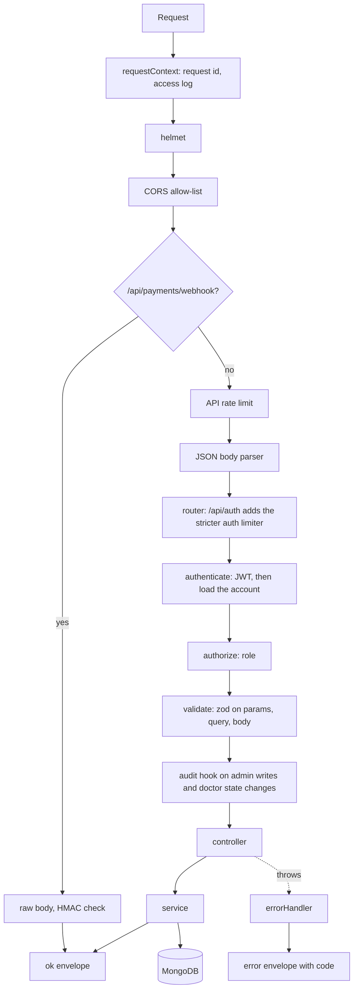
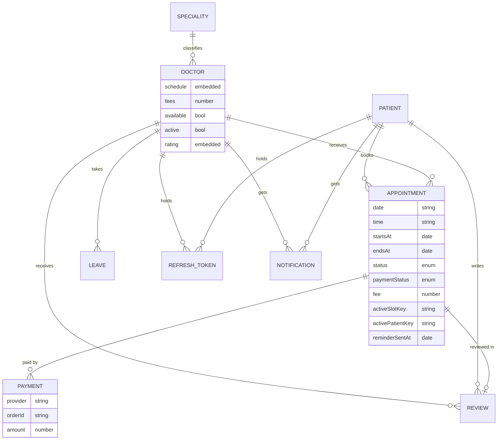
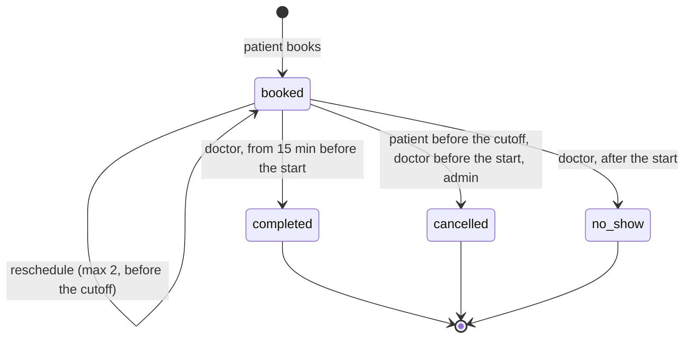
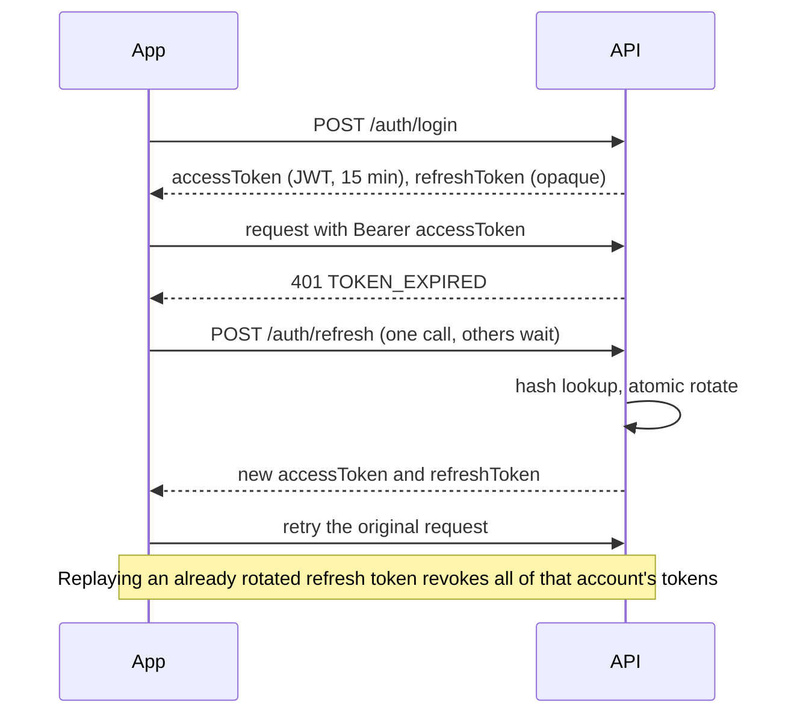
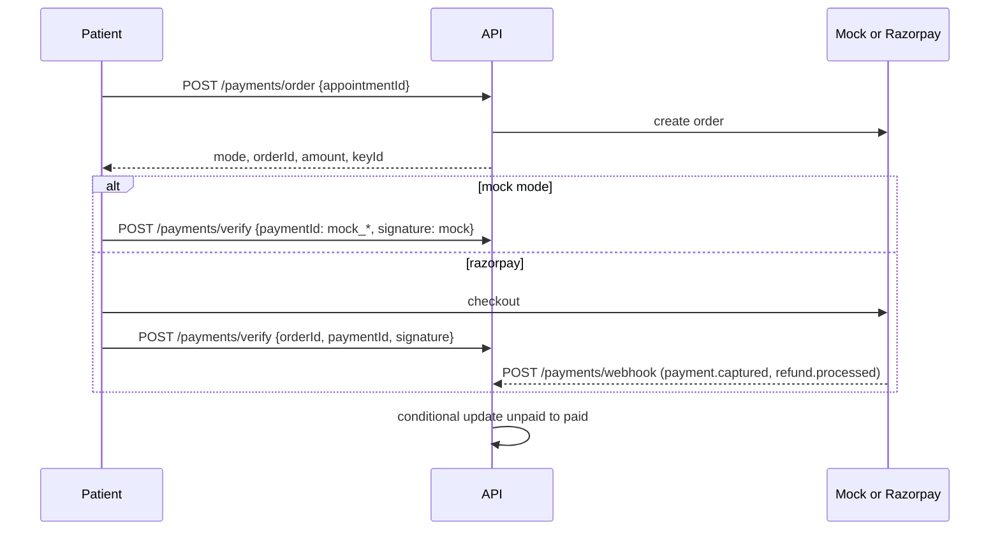

# Architecture

Three deployable parts share one contract, [`API.md`](API.md): the API (`Backend/`), the patient app
(`Book-My-Appointment/`) and the staff console (`admin/`). The apps never talk to each other; both talk to the API,
and the API owns all rules and all data (MongoDB).

## Backend

### Module layout

```
src/
  app.js         createApp({ config, logger?, overrides? }): builds the Express app, never listens
  server.js      loads config, connects, listens, starts the job, handles SIGTERM and fatal errors
  container.js   builds the services and wires them together; clock, mailer, payments, storage and
                 the Google verifier can be replaced through `overrides` (tests do)
  config/        env.js (zod schema and production guards), db.js
  middlewares/   requestContext, authenticate, authorize, validate, rateLimiters, upload, audit,
                 idempotency, cache, errorHandler
  utils/         AppError, asyncHandler, pagination, crypto, csv, time, logger, shared schemas
  modules/<domain>/   model, service, controller, routes, validators
    auth patients doctors specialities scheduling appointments payments reviews
    notifications admin analytics audit settings health uploads
```

Controllers parse the request and call a service; services own the rules and talk to Mongoose; routes only
declare paths, validation and guards. Because `createApp` receives its dependencies, the same code runs in tests
with a fake clock and an in-memory outbox.

### Request lifecycle



Every success is `{ success: true, data }`; every failure is `{ success: false, error: { code, message, details } }`
with the HTTP status for that code. Unknown errors become `500 INTERNAL` and are logged with the request id; the
client never sees internals.

### Data model



Notes: `AuditLog` (400-day TTL), `Settings` (one document, key `global`), `Otp`, `PasswordReset` and `LoginAttempt` are
standalone collections. Appointments embed snapshots of the patient and doctor (`patientInfo`, `doctorInfo`) and
the fee, so history stays correct when profiles change. Notifications expire after 120 days.

### Scheduling and time zones

A doctor's `schedule` is a slot length plus at most one entry per weekday with working hours and breaks.
`modules/scheduling/engine.js` is a pure function: given a date, the schedule, leave days, the booked times, `now`
and the booking window, it returns the day's slots. A slot is offered when it fits inside working hours, avoids
breaks, is not a leave day, lies within `bookingWindowDays` of today, starts at least 30 minutes from now and is not
held by a `booked` or `completed` appointment. `scheduling.service.js` loads those inputs.

All dates and times in the contract are wall-clock values in the clinic timezone (`CLINIC_TIMEZONE`). `utils/time.js`
converts between a zone's wall time and UTC using `Intl.DateTimeFormat` only (no date library): a wall time inside a
spring-forward gap yields no slot, and one that occurs twice at fall-back resolves to the first occurrence. Each
appointment stores both the wall-clock `date`/`time` and the UTC `startsAt`/`endsAt`; queries and analytics use
the instants, display uses the wall clock plus the stored timezone.

### Preventing double booking

An appointment that holds a slot carries `activeSlotKey = doctorId:date:time` and
`activePatientKey = patientId:startsAtMillis`. Each is covered by a unique index that only applies while the field is
a string (a partial index). Booking inserts the document; if two requests race, the database accepts one and
rejects the other with a duplicate-key error, which the service maps to `409 SLOT_TAKEN` (or `409 CONFLICT` when the
patient already has something at that time). Cancelling or marking a no-show unsets both keys, freeing the slot.
Rescheduling swaps both keys inside a single atomic `findOneAndUpdate`, so it cannot lose a race either.
`POST /appointments` also accepts an `Idempotency-Key` header so a retried request cannot book twice.

### Appointment state machine



`appointments/stateMachine.js` holds the transition table and the per-action checks (role, ownership, cutoff,
reschedule count, timing). The same checks produce the `actions` flags in every appointment response, which is why
the apps never decide permissions themselves. Violations return `422 INVALID_STATE`, `422 CANCELLATION_WINDOW_PASSED`
or `403 FORBIDDEN`; looking up someone else's appointment returns `404`.

### Token lifecycle



The access token holds only `sub` and `role`. `authenticate` still loads the account on every request, so blocking
a patient or deactivating a doctor takes effect immediately (`403 ACCOUNT_BLOCKED`). Refresh tokens are 48 random
bytes stored as SHA-256 hashes. Blocking, deactivating, logging out and password resets revoke them. OTPs (6 digits
from `crypto.randomInt`, hashed with the refresh secret as the key, 10 minutes, 5 attempts, 60-second
resend cooldown) and reset tokens (30 minutes, single use) are stored hashed. Failed logins are counted per account
and role and lock the account for a while; admin login is audited.

### Payments



`modules/payments/providers.js` offers one interface (`createOrder`, `verifyPayment`, `verifyWebhook`, `refund`)
with two implementations. Signatures are checked with HMAC-SHA256 and `timingSafeEqual`; the webhook route is
mounted before the JSON parser because the signature covers the raw bytes. Every state change is a conditional
update (`paymentStatus: 'unpaid'` to `'paid'`, `'refund_pending'` to `'refunded'`), so webhook replays and a
webhook racing the client's verify call are harmless. Mock mode is refused next to live keys in production.
Cancelling a paid appointment sets `refund_pending`; the mock provider completes it immediately, Razorpay either
immediately or through the `refund.processed` webhook.

### Reminder and refund job

`notifications/reminderJob.js` runs every `REMINDER_INTERVAL_MINUTES`. Each tick claims due appointments (`booked`,
starting within `REMINDER_LEAD_HOURS`, `reminderSentAt: null`) one at a time with `findOneAndUpdate`, which sets
`reminderSentAt` atomically, so a reminder is sent at most once even with several API instances. It creates a
notification and emails the patient; an email failure is logged and never undoes the claim. The same tick then runs
the sweeps, currently the refund retry that re-attempts `refund_pending` payments whose provider call failed
(with a cool-down). `runOnce(now)` is exported for tests, and `REMINDERS_ENABLED=false` disables the whole job.

### Analytics

All analytics are MongoDB aggregations over `appointments` (and `reviews`), run on demand.
- **summary:** `$group` by status for the counts, a paid-revenue `$group` (all time and last 30 days), doctor and
  patient counts, and the average review rating.
- **timeseries:** `$match` on the `startsAt` range (converted from clinic-local days to instants), `$group` by a
  period label made with `$dateToString` and, for weeks, `$dateTrunc` starting Monday, both in the clinic timezone.
  The service then fills in every period of the range with zeros, so charts never have holes.
- **specialities** and **top-doctors:** `$group` by the snapshotted speciality or the doctor, with revenue counted
  only for `paymentStatus: 'paid'` appointments.
Revenue is always the sum of `fee` over paid appointments.

## Frontends

Both SPAs are React 18 with Vite, Tailwind, Redux Toolkit (session and notifications only), React Router 6 and
axios. Server data is not kept in Redux; each screen fetches what it needs through small hooks.

**Shared approach.** An axios client unwraps the envelope and throws an `ApiError` carrying `code`, `status` and
`details`. Screens show messages from a table keyed by error code. The client stores the tokens in `localStorage`
(`bma.patient.auth`, `bma.staff.auth`) and refreshes on `401 TOKEN_EXPIRED` through a single in-flight promise,
retrying the original request; if the refresh fails it clears the session and sends the user to the login page.

**Patient app (`Book-My-Appointment/src`).** `api/` has one module per domain; `features/` has the auth and
notification slices plus the payment hook; `hooks/` has `useQuery`/`useAction` and `usePublicSettings`;
`pages/` are lazy-loaded routes behind a `ProtectedRoute`. Slots always come from the API and are displayed in the
clinic timezone the API reports. Appointment buttons are driven only by the `actions` flags. The slot picker and
the cancel dialog take the booking window and cancellation cutoff from `GET /settings/public`.

**Staff console (`admin/src`).** One login for both roles, with role-based layouts and route guards: an admin
visiting `/doctor` is redirected to `/admin` and vice versa. Data screens use a `useFetch` hook with reload, and
filters persist per screen. The doctor area has a week-grid calendar (`components/calendar`) with keyboard shortcuts,
a schedule editor with client-side validation that mirrors the server's rules, and the consultation modal with the
prescription builder. The admin area has the analytics dashboard (charts are small hand-written SVG components),
data tables with drawers and confirm dialogs, and the CSV export (a blob download through the same client).

## Delivery

`docker-compose.yml` runs `mongo`, `backend` (non-root, health check on `/api/health`), and the two SPAs as nginx
images with a single-page-app fallback; the API URL is compiled into the SPAs at build time. CI
(`.github/workflows/ci.yml`) lints, tests with coverage and builds each app, audits production dependencies, and
runs the Playwright suite against the real stack.
